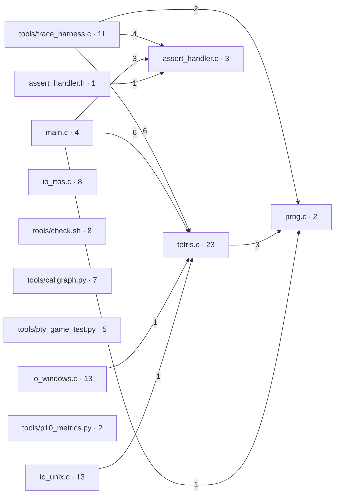
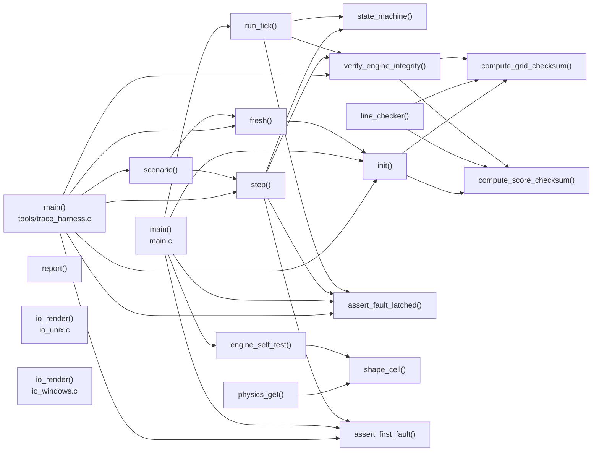

# Codemap: spacetetris

← [README](README.md)

> Generated from commit `ca76fd5` by `scripts/codemap.py`. Regenerate it from the workspace root with `python3 scripts/codemap.py spacetetris`; don't edit it by hand.

## Files

Each box is a source file and its function count; an arrow means calls into that file.

## Hubs

The most connected functions: where a change reaches furthest.

| Function | Where | Called by | Calls |
|---|---|---|---|
| `main()` | `tools/trace_harness.c:128` | 0 | 10 |
| `state_machine()` | `tetris.c:75` | 2 | 6 |
| `init()` | `tetris.c:42` | 4 | 2 |
| `line_checker()` | `tetris.c:500` | 1 | 5 |
| `main()` | `main.c:12` | 0 | 6 |
| `physics_get()` | `tetris.c:359` | 5 | 1 |
| `step()` | `tools/trace_harness.c:86` | 2 | 4 |
| `compute_grid_checksum()` | `tetris.c:597` | 4 | 1 |
| `engine_self_test()` | `tetris.c:648` | 1 | 4 |
| `report()` | `tools/callgraph.py:101` | 1 | 4 |
| `run_tick()` | `main.c:51` | 1 | 4 |
| `verify_engine_integrity()` | `tetris.c:634` | 3 | 2 |
| `assert_fault_latched()` | `assert_handler.c:19` | 4 | 0 |
| `compute_score_checksum()` | `tetris.c:614` | 3 | 1 |
| `fresh()` | `tools/trace_harness.c:98` | 2 | 2 |
| `io_render()` | `io_unix.c:114` | 0 | 4 |
| `io_render()` | `io_windows.c:76` | 0 | 4 |
| `scenario()` | `tools/trace_harness.c:109` | 1 | 3 |
| `shape_cell()` | `tetris.c:301` | 4 | 0 |
| `assert_first_fault()` | `assert_handler.c:21` | 3 | 0 |

## Functions

### `assert_handler.c`

- `assert_record()` L11
- `assert_fault_latched()` L19
- `assert_first_fault()` L21

### `assert_handler.h`

- `assert_fail()` L53 → `assert_record()`

### `io_rtos.c`

- `io_delay_ms()` L16
- `io_get_seed()` L20
- `io_get_keypress()` L28
- `io_render()` L32
- `io_show()` L40
- `io_read_menu_selection()` L47
- `io_read_char()` L51
- `io_display_fault()` L57

### `io_unix.c`

- `io_delay_ms()` L25
- `io_get_seed()` L56
- `io_get_keypress()` L77
- `io_render()` L114 → `put()`, `render_hud()`, `render_board()`, `render_game_over()`
- `render_hud()` L144
- `render_board()` L153 → `put()`, `cell_filled()`
- `render_game_over()` L177
- `put()` L193
- `io_show()` L202 → `put()`, `io_delay_ms()`
- `io_read_menu_selection()` L253 → `read_line_first_char()`
- `io_read_char()` L255 → `read_line_first_char()`
- `read_line_first_char()` L262
- `io_display_fault()` L293

### `io_windows.c`

- `io_delay_ms()` L26
- `io_get_seed()` L57
- `io_get_keypress()` L66
- `io_render()` L76 → `put()`, `render_hud()`, `render_board()`, `render_game_over()`
- `render_hud()` L106
- `render_board()` L115 → `put()`, `cell_filled()`
- `render_game_over()` L139
- `put()` L155
- `io_show()` L164 → `put()`, `io_delay_ms()`
- `io_read_menu_selection()` L215 → `read_line_first_char()`
- `io_read_char()` L217 → `read_line_first_char()`
- `read_line_first_char()` L224
- `io_display_fault()` L255

### `main.c`

- `main()` L12 → `run_tick()`, `engine_self_test()`, `prng_init()`, `init()`, `assert_fault_latched()`, `assert_first_fault()`
- `run_tick()` L51 → `handle_key()`, `assert_fault_latched()`, `state_machine()`, `verify_engine_integrity()`
- `handle_key()` L84 → `input()`, `init()`
- `input()` L115 → `physics_get()`

### `prng.c`

- `prng_init()` L7
- `prng_next()` L16

### `tetris.c`

- `init()` L42 → `compute_grid_checksum()`, `compute_score_checksum()`
- `state_machine()` L75 → `handle_tetriswait()`, `handle_menu()`, `handle_game_start()`, `handle_block_fall()`, `handle_block_stop()`, `handle_line_check()`
- `handle_game_start()` L114 → `shuffle_bag()`, `spawn_piece()`
- `handle_block_fall()` L129 → `physics_get()`
- `handle_block_stop()` L151 → `physics_get()`, `physics_set()`
- `handle_line_check()` L168 → `line_checker()`
- `handle_tetriswait()` L181 → `spawn_piece()`, `physics_get()`
- `handle_menu()` L203
- `shuffle_bag()` L239 → `prng_next()`
- `spawn_piece()` L273 → `shuffle_bag()`
- `shape_cell()` L301
- `physics_get()` L359 → `shape_cell()`
- `physics_set()` L405 → `shape_cell()`, `compute_grid_checksum()`
- `cell_filled()` L438 → `shape_cell()`
- `row_is_full()` L466
- `remove_row()` L482
- `line_checker()` L500 → `row_is_full()`, `remove_row()`, `points_for_lines()`, `compute_grid_checksum()`, `compute_score_checksum()`
- `points_for_lines()` L546
- `crc8_update()` L584
- `compute_grid_checksum()` L597 → `crc8_update()`
- `compute_score_checksum()` L614 → `crc8_update()`
- `verify_engine_integrity()` L634 → `compute_grid_checksum()`, `compute_score_checksum()`
- `engine_self_test()` L648 → `crc8_update()`, `shape_cell()`, `prng_init()`, `prng_next()`

### `tools/callgraph.py`

- `build()` L41
- `parse()` L54
- `find_cycles()` L70
- `visit()` L73
- `deepest()` L90
- `report()` L101 → `build()`, `parse()`, `find_cycles()`, `deepest()`
- `main()` L145 → `report()`

### `tools/check.sh`

- `pass()` L31
- `fail()` L32
- `skip()` L37
- `section()` L38
- `have()` L39
- `cfg_files()` L40
- `replace_once()` L43
- `scratch_copy()` L55

### `tools/p10_metrics.py`

- `functions()` L47
- `main()` L74 → `functions()`

### `tools/pty_game_test.py`

- `pump()` L17
- `wait_for()` L28 → `pump()`
- `check()` L40
- `play_until_game_over()` L45 → `pump()`
- `frame_after_without_game_over()` L56 → `pump()`

### `tools/trace_harness.c`

- `rand()` L39 → `prng_next()`
- `srand()` L40
- `delay_ms()` L41
- `next_input()` L46
- `drive_input()` L52 → `physics_get()`
- `grid_hash()` L69
- `dump()` L79 → `grid_hash()`
- `step()` L86 → `state_machine()`, `verify_engine_integrity()`, `assert_fault_latched()`, `assert_first_fault()`
- `fresh()` L98 → `prng_init()`, `init()`
- `scenario()` L109 → `fresh()`, `step()`, `dump()`
- `main()` L128 → `fresh()`, `scenario()`, `next_input()`, `drive_input()`, `step()`, `dump()`, `verify_engine_integrity()`, `assert_fault_latched()`, `assert_first_fault()`, `init()`
