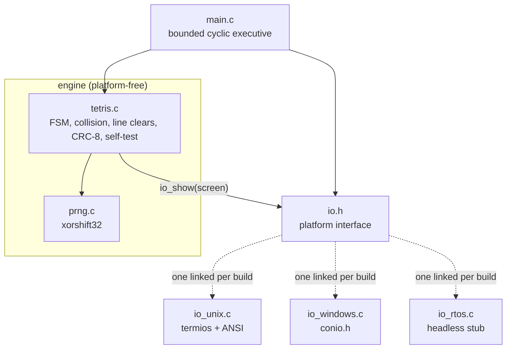
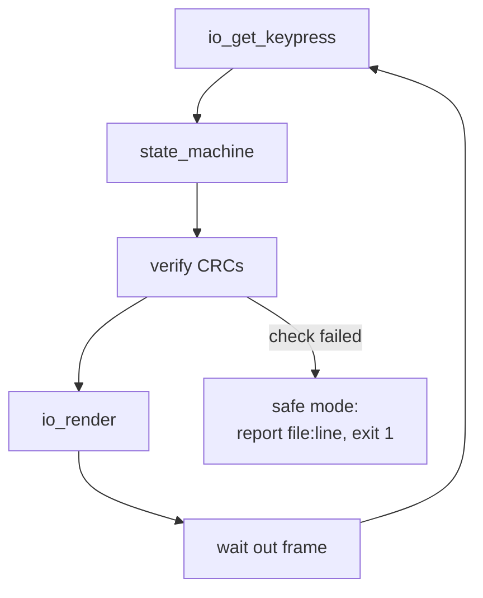
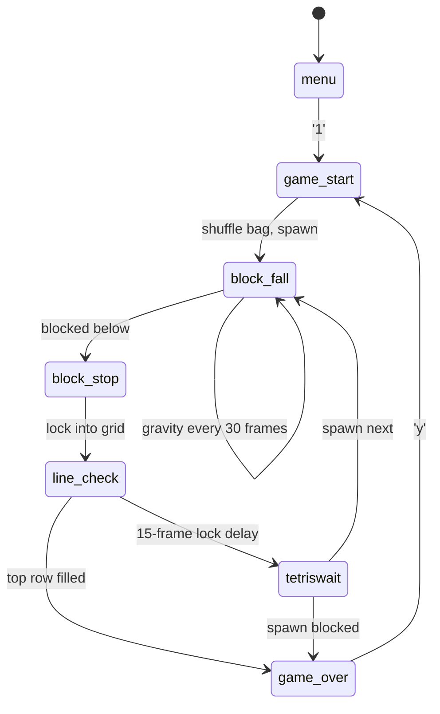

# spacetetris

> A from-scratch Tetris engine in C that follows MISRA C:2012 and the JPL Power of 10 rules, with four documented deviations.


## Overview

Built to learn strict memory discipline, deterministic state machines and hardware abstraction in the style flight software uses. The engine is platform-free; one I/O port is linked in per target, with no `#ifdef` anywhere. The Linux port is the one that runs and is tested. The Windows port is syntax-checked only, and the RTOS port is a headless stub until a real RTOS port lands.

## Architecture



The engine says *what* happens (`io_show(IO_SCREEN_GUIDE)`); the port decides *how* it looks. Calls only ever go engine → port. Every file reports a failed check through `TETRIS_ASSERT` in `assert_handler.c`, which stops the game in safe mode.

## One Tick



Power-on self-test first (shape table, CRC-8, PRNG against known answers), then at most 10 hours of ticks at 60 FPS (JPL rule 2).

## State Machine



| | |
|---|---|
| **Randomizer** | 7-bag Fisher-Yates on xorshift32 (MISRA bans `rand()`) |
| **Scoring** | 100 / 300 / 500 / 800 for 1–4 lines |
| **Types** | `stdint.h` widths only; `active_piece_t.x` is `int8_t` so left of column 0 is −1, not 255 |
| **Checks** | 69 recovering `TETRIS_ASSERT`s, CRC-8 over grid and score every tick |
| **Controls** | `a` left · `d` right · `s` soft drop · `w` rotate |

## Build

```bash
gcc @gcc-strict.flags tetris.c prng.c assert_handler.c io_unix.c main.c -o spacetetris      # Linux / macOS
gcc @gcc-strict.flags tetris.c prng.c assert_handler.c io_windows.c main.c -o spacetetris.exe  # MinGW
gcc @gcc-strict.flags tetris.c prng.c assert_handler.c io_rtos.c main.c -o spacetetris-headless
```

Swap in `clang @clang-strict.flags` for clang. Every warning is an error (JPL rule 10). The headless build plays one silent game and exits.

## Verification

```bash
tools/check.sh          # everything, ~5 min on a Raspberry Pi
tools/check.sh --quick  # skips the real-terminal game
```

It covers both compilers, both static analyzers, MISRA (cppcheck), Power of 10 (Cobra), a tick-by-tick replay against v1, planted faults, and a game played in a pseudo-terminal.

| Doc | What's in it |
|---|---|
| [REFACTOR-GOALS.md](REFACTOR-GOALS.md) | The spec: rule-by-rule audit of v1 |
| [REFACTOR-REPORT.md](REFACTOR-REPORT.md) | Every v1 → v2 change, before and after |
| [COMPLIANCE.md](COMPLIANCE.md) | The evidence: flags, tool results, deviations |
| [CODEMAP.md](CODEMAP.md) | Files, hub functions and the call graph, generated from the code |

---
*powered by logic, coffee, and many sleepless nights*
